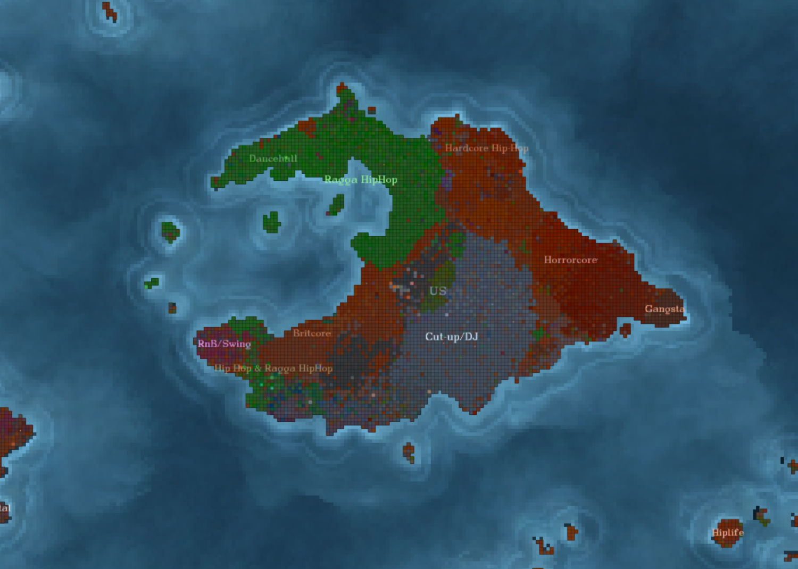
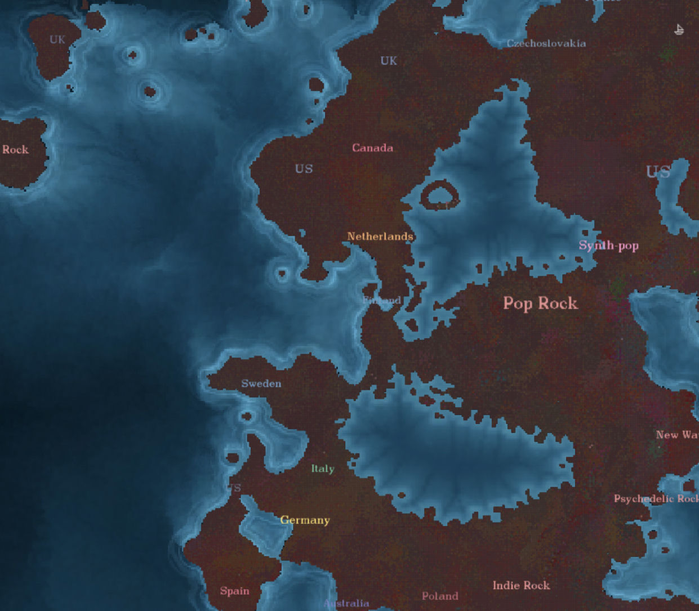
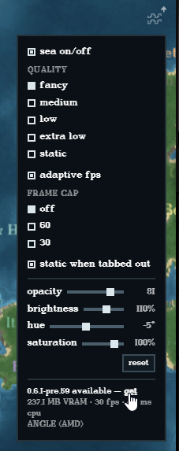
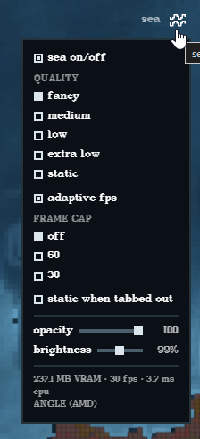

# Sea-Zag

An unofficial sea for the zig-zag.fm map.

Ever looked at the various archipelagoes on zigzag and try to imagine the Seas
between them? Sea-Zag paints the empty space between the archipelagos with the
blue abyss.

## What it do:

- Procedurally generated sea with underwater features, formed through currents,
  erosion and some artistic licence.
- Currents calculated around the open bodies of water, pushing through the
  passages between the islands.
- Dynamic visual effects: Parallax occlusion mapping, waves hitting the coasts,
  water moving with the currents.

- easter egg?

## Install

1. Install [Tampermonkey](https://www.tampermonkey.net/) in your browser.
2. Open
   [`sea-zag.user.js`](https://raw.githubusercontent.com/rich0664/sea-zag/main/dist/sea-zag.user.js)
   and let Tampermonkey install it.
3. Open the exploration map on zig-zag.fm. A small pixel-wave button appears
   under the notifications button in the header.

Tampermonkey updates the script on its own, so you only need the link once. To
start over, remove the script from Tampermonkey and install it again. If the map
ever looks wrong after an update, reload the page once.

If the script doesn't show up in Tampermonkey after installing it, the browser is
blocking userscripts. In Chrome and Edge, open the extensions page, open
Tampermonkey's details, and turn on "Allow user scripts" — on older versions,
turn on developer mode instead. In Firefox, check that Tampermonkey is allowed to
run on zig-zag.fm.

## Updating

Tampermonkey updates the script on its own. When a newer version is waiting, the
pixel-wave button grows an arrow in its top corner and the bottom of the panel
names it — `0.6.1 available — get`.

Click **get**, let Tampermonkey install it, then reload the page. Once you are on
the latest, that line reads `up to date · 0.6.1`.

## Settings

Click the pixel-wave button under the notification button to open the panel.

